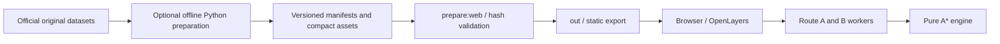

# Mars Pathfinder implementation architecture

## Runtime and build

Next.js 16.4.6 / React 19.3.1 / TypeScript 7, OpenLayers 10.11 and two module Web Workers. `package-lock.json` pins the dependency graph; Node 24+ is required. Python/GDAL tooling prepares scientific assets separately and is not required to build or run the compact web release.

| Path | Responsibility |
| --- | --- |
| `app/`, `components/mission/` | Page, mission interface and map lifecycle |
| `lib/map/`, `lib/science/` | Coordinates, display contracts, comparison and provenance |
| `lib/routing/engine.ts`, `grid.ts`, `heap.ts` | A*, legal edges, metrics and indexed priority queue |
| `lib/routing/load-grid.ts` | Prepared-grid loading and validation |
| `worker-client.ts`, `worker-protocol.ts` in `lib/routing/` | Request identity, transport and cancellation |
| `workers/routing.worker.ts` | Worker entry; no LLM or network routing service |
| `scripts/routing/build-worker.mjs` | Bundles the worker into `dist/workers/` |
| `scripts/web/sync-assets.mjs` | Verifies byte counts/hashes and synchronizes prepared assets |
| `scripts/web/serve-static.mjs` | Serves `out/` on loopback, default port 3000 |
| `scripts/data/`, `tests/test_*.py` | Optional geospatial preparation and independent verification |

`npm run build` bundles workers, validates/synchronizes assets, then exports Next.js into `out/`. Netlify publishes that folder without a server adapter. `npm start` serves the static build; it does not compute routes on a Node backend.

## Scientific data contract

The routing grid is 394×356 at 10 m, north-first row-major. Elevation and slope are Float32 little-endian; validity is Uint8. Manifests bind binary arrays, visuals and scientific assets using SHA-256, byte sizes and a local Martian CRS. Preserve exact bytes and upstream credits. A cell's size is not an absolute positional-accuracy claim.

The pure engine evaluates eight neighbors, blocks NoData, excess cell slope and segment grade, and prevents cutting blocked diagonal corners. Route A has lambda 0; B defaults to 4. A Euclidean horizontal heuristic accompanies nonnegative edge cost. Slope limits are team assumptions, not certified astronaut constraints. Cancellation terminates/recreates a synchronous worker; request identity prevents stale results from replacing newer requests.

Geology and photos are contextual science layers, not routing barriers. Geological offsets and rover-photo localization limits remain visible. Synthetic tests are separate from real Martian observations.

## Reproduction and mutable outputs

The manual demo and Start Mission use different destinations: `npm run demo:routes` is not automatically the M3 presentation experiment. Keep endpoint coordinates, engine version, parameters and manifest identity with every comparison.

Some browser tests and `demo:routes` write tracked historical evidence, routes, screenshots or generated worker assets. Run them in an isolated working copy, inspect `git status`, and do not commit those outputs incidentally with source/documentation changes. Reports describe their original date and scope until deliberately regenerated and reviewed.

See [README](README.md), [reproduction scope](docs/REPRODUCIBILITY.md), [scientific resources](docs/NASA_RESOURCES.md), [licensing](docs/LICENSING.md) and [current status](PROJECT_STATUS.md).
