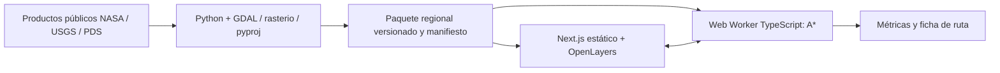

# Mars Pathfinder — The Meowrtian

Plan para la ventana de trabajo indicada por el equipo: **14–15 de noviembre de 2026, Europe/Madrid**.

**Estado actualizado: datos topográficos, A*, workers y aplicación Next.js/OpenLayers comprobados; geología SIM 3464, tres objetivos del equipo y dos fotos Perseverance integrados y validados.** 37 pruebas del motor, 27 de interfaz/ciencia y 22 pytest aprobadas. Se conservan arquitectura y fuentes. Véanse [rutas](docs/VALIDACION_RUTAS.md), [interfaz inicial](docs/VALIDACION_INTERFAZ.md) y [recursos NASA/USGS](docs/NASA_RESOURCES.md). El despliegue y las comprobaciones fuera del equipo de demo siguen pendientes.

## 1. Decisión y alcance

Construir un planificador 2D de recorridos de exploración en una región pequeña de Jezero: seleccionar origen y destino, consultar puntos de interés científico y comparar distancia con penalización de pendientes. Presentarlo como un prototipo educativo de planificación, con riesgos topográficos estimados; estos datos no permiten certificar una ruta para una EVA real.

**Región seleccionada para HiRISE:** rectángulo `[77.40, 18.42, 77.47, 18.48]`, en orden `[oeste, sur, este, norte]`, longitudes este y latitudes planetocéntricas de Marte. Son aproximadamente 3.9 × 3.6 km sobre la esfera marciana de referencia. El recorte ajustado a 2 m mide 3936 × 3560 m y su máscara útil ya se ha validado. La identificación y documentación de objetivos científicos sigue pendiente; se permite ajustar la región si lo exige esa integración.

### MVP obligatorio

- Mapa interactivo con imagen orbital, escala métrica, coordenadas marcianas y límites del área con datos.
- Tres dominios científicos: imagen orbital, topografía de DEM estéreo y unidades geológicas publicadas. Pendiente y sombreado son derivados del DEM, no dominios adicionales independientes.
- Capas de elevación, pendiente y geología con leyenda, procedencia y resolución/incertidumbre.
- Al menos tres POI seleccionados a partir de evidencia publicada y de las capas, con justificación y localización trazables.
- A* entre dos posiciones válidas; el destino puede ser un POI. Comparación de recorrido corto y recorrido con penalización de pendiente, bajo las mismas restricciones.
- Distancia horizontal y sobre el terreno, ascenso/descenso acumulados, desnivel neto, pendiente máxima y exposición a clases de pendiente.
- Estados explícitos: sin ruta, origen/destino fuera del área, celda bloqueada, datos ausentes, carga y error.
- Procedencia visible y exportación de una ficha JSON de ruta y supuestos.
- Pruebas automatizadas, documentación reproducible, build estático desplegable y demo de 3 minutos.

### Fuera del MVP

Globo/terreno 3D, todo Jezero, cuentas, base de datos, meteorología en directo, oxígeno/energía de EVA, radiación espacialmente resuelta, capacidad portante del suelo, detección automática de rocas, inferencias de agua o vida y optimización de una expedición con múltiples destinos. Añadir capas espectrales o térmicas requiere comprobar primero un producto concreto, su cobertura y su interpretación.

## 2. Resultado de la investigación inicial, fase 0

El registro con enlaces exactos y evidencias está en [docs/FUENTES.md](docs/FUENTES.md).

| Opción verificada | Productos y disponibilidad | Compatibilidad observada | Decisión |
| --- | --- | --- | --- |
| HiRISE PDS, par ESP_045994 / ESP_046060 | DEM IMG de 380,814,764 bytes + orto RED_C JP2 de 33,534,820 bytes + etiqueta; HTTP 200 y lecturas parciales 206 | Etiquetas con idéntica proyección, tamaño 6673 × 14266, paso 1.0096633268711 m y límites | **Preferida para el MVP:** unos 414 MB de archivos principales; probar antes los drivers PDS y JP2 de GDAL |
| HiRISE USGS TRN | DEM TIFF de 1,839,545,409 bytes + orto BigTIFF de 7,358,523,457 bytes; 200/206 | GeoKeys iguales, origen común, misma extensión; pasos 1 m y 0.25 m, relación exacta 1:4 | Alternativa de alta resolución si la lectura por ventanas es eficiente; evitar descargar los ~9.2 GB completos |
| CTX USGS | DEM de 90,345,300 bytes + orto de 36,269,402 bytes; 200/206 | Ambos cubren el rectángulo, pero usan paralelos estándar distintos: necesitan reproyección | Respaldo de menor volumen, unos 127 MB; rutas regionales a resolución de DEM de 20 m |
| Geología USGS SIM 3464 | ZIP de 349,336,873 bytes; 200; índice ZIP y archivos de proyección leídos parcialmente | Cubre 76.8–77.8° E, 17.7–18.7° N; File Geodatabase en TM marciana | Tercer dominio científico; contexto y selección de POI, sin usar contactos como barreras precisas |

**Incidencias relevantes:**

1. El DEM TRN correcto contiene `MOLAtopography` en el nombre. La variante `MOLA_topography`, presente en algunas referencias, terminó en **404**. Se conserva la comprobación de ambas.
2. Las páginas de catálogo USGS devolvieron 403 en el navegador de investigación, mientras que solicitudes directas pudieron leer productos públicos y sus metadatos. Hubo un 502 transitorio en el enlace CTX; su destino S3 se verificó también.
3. El README y los metadatos de SIM 3464 advierten desfases de aproximadamente **100–200 m** respecto al mosaico CTX de operaciones. Reproyectar no elimina ese desfase. Mantener la advertencia en el mapa, los POI y la exportación; no aplicar una traslación arbitraria.
4. El par PDS se anuncia nominalmente a 1 m/píxel; la etiqueta declara **1.0096633268711 m/píxel**. No confundir muestreo con exactitud vertical u horizontal.
5. Se comprobaron cabeceras, etiquetas, límites y formatos. **No se han validado todos los píxeles del rectángulo ni se ha certificado la alineación visual.** Son puertas de salida de la fase 1.

## 3. Contrato científico y geoespacial

### Procedencia

Separar el origen del dato de su procesamiento. Un DEM estéreo oficial es un producto científico derivado de observaciones reales; una unidad geológica es una interpretación publicada.

| Etiqueta en la aplicación | Contenido |
| --- | --- |
| Real · producto orbital procesado | Ortoimagen NASA/MRO/HiRISE o CTX |
| Real · derivado oficial | Elevación estéreo publicada; no presentarla como medición puntual directa |
| Real · interpretación publicada | Unidades y contactos geológicos USGS, conservando incertidumbre |
| Derivado · The Meowrtian | Recorte, reproyección, pendiente, sombreado, selección de POI, ruta y métricas |
| Simulado · supuesto de demo | Origen de la expedición, límites de pendiente y pesos de coste elegidos por el equipo; nunca estaciones NASA ficticias |

Cada capa/producto tendrá: `id`, versión, categoría de procedencia, organismo/autores, producto fuente, URL/DOI, fecha de adquisición si consta, fecha de descarga, CRS completo, resolución, NoData, unidades, referencia vertical, transformaciones y checksum. Los checksums de cabeceras guardados ahora no sustituyen el SHA-256 de los archivos completos que se descarguen después.

### Coordenadas y preparación

- Conservar las etiquetas PDS y los WKT/GeoKeys originales. No asignar EPSG:4326 ni EPSG:3857 a datos de Marte.
- Proyectar la región a una cuadrícula local común. Propuesta: equirectangular marciana con `R=3396190 m`, `lat_ts=18.45`, `lon_0=77.435`, `lat_0=0`, unidades en metros. Verificar la transformación desde cada CRS fuente con GDAL/PROJ y registrar el WKT final.
- El PDS usa otra esfera auxiliar y otro paralelo estándar; CTX y geología también difieren en proyección. Transformar sus coordenadas; no copiar coordenadas proyectadas entre capas.
- Conservar el datum vertical de **un único DEM** por versión. La etiqueta PDS especifica elevación sobre la superficie equipotencial marciana. Para cambiar al DEM TRN o CTX, comprobar su referencia vertical y regenerar derivados; no mezclar alturas sin justificación.
- DEM/imagen: remuestreo continuo documentado, con NoData excluido. Geología/máscaras: vecino más próximo o geometría vectorial. No rellenar huecos como terreno llano.
- Preparar imagen visible a 2–4 m/píxel y malla A* de **10 m** para HiRISE; objetivo ≤250,000 celdas. Con respaldo CTX, malla de **20 m o más**; interpolarlo a 1 m no crea detalle científico.
- Calcular pendiente sobre el DEM en coordenadas métricas locales antes de reducir la malla. Agregar de forma conservadora la pendiente máxima y la invalidez dentro de cada celda de ruta; documentar escala y método. Añadir margen de datos alrededor del recorte para el cálculo de gradientes.
- Una celda parcialmente desconocida queda bloqueada. Conservar máscara de validez y una banda de exclusión en los bordes sin vecindad suficiente.
- Geología para contexto y ciencia: conservar identificadores originales y nombres publicados, sin atribuir resistencia mecánica o toxicidad a una unidad.
- Almacenar geometrías de la app en JSON con CRS marciano explícito y coordenadas locales `x/y`. La exportación marciana no se anunciará como GeoJSON RFC 7946/WGS84.

### POI

Seleccionar tres sitios dentro de la máscara válida, utilizando unidades presentes y rasgos visibles contrastados con fuentes. Candidatos temáticos: depósitos de abanico, transiciones entre unidades y unidades del suelo del cráter, **solo si su presencia queda comprobada**. No fijar todavía nombres ni coordenadas de estaciones.

Cada ficha incluirá la pregunta científica, fuente, unidad original, método de localización, incertidumbre y etiqueta de selección del equipo. Si la posición procede de SIM 3464, mostrar el desfase documentado de 100–200 m; no tratar su centro como un afloramiento medido con precisión métrica. No inventar nombres oficiales ni abundancias minerales.

## 4. Arquitectura propuesta

**Next.js + TypeScript, OpenLayers, A* en un Web Worker y Python únicamente para preparar datos.** Sin servicio Python en producción ni base de datos para este MVP.



- **Python:** NumPy, rasterio/GDAL, pyproj y acceso a FileGDB mediante GDAL OpenFileGDB. Fijar versiones después de comprobar compatibilidad; ejecutar en entorno aislado. Pytest para transformaciones y derivados.
- **Web:** Next.js App Router con exportación estática; mapa en componente de cliente. OpenLayers permite una proyección y una extensión propias, evitando las distancias terrestres por defecto.
- **Ruta:** TypeScript puro, independiente de React; arrays tipados y heap, ejecución cancelable en worker. Vitest para algoritmo y métricas; Playwright para el flujo de navegador cuando esté disponible el entorno.
- **Contrato de datos:** manifiesto JSON y esquema compartido; rejillas Float32, máscaras Uint8 y geometrías locales. Origen superior izquierdo, tamaño de celda, orden de filas y endianness explícitos. Sin NaN implícito en JSON: usar máscara/valor nulo.
- **Distribución:** activos regionales propios y versionados; nada depende de NASA/USGS en tiempo de uso. Objetivo inicial de paquete comprimido ≤30 MB y carga inicial ≤10 MB, sujetos a medición real.
- **Despliegue:** `next build` con `output: 'export'`, salida `out/`, en hosting estático HTTPS. Conservar instrucciones genéricas y elegir el proveedor disponible en fase 5. No se necesita una API `/route` en este alcance.

Estructura prevista; ya se han creado la preparación de datos, sus pruebas y documentación. La aplicación sigue pendiente:

```text
app/                         interfaz y vista de fuentes
components/map/              capas y controles
lib/routing/                 A*, costes y métricas
workers/                     planificación fuera del hilo de UI
scripts/data/                descarga y preparación Python
public/data/jezero-v1/        paquete recortado y manifiesto
data/raw/                    caché local excluida del repositorio
tests/                       unitarias, datos y navegador
docs/                        fuentes, método, limitaciones y demo
```

Referencias de las decisiones: [exportación estática de Next.js](https://nextjs.org/docs/app/guides/static-exports) y [proyección propia en OpenLayers](https://openlayers.org/en/latest/examples/static-image.html). Dependencias instaladas localmente y fijadas en `package-lock.json` durante la fase de interfaz.

## 5. Método A* y métricas

### Grafo y restricciones

Ocho vecinos, sin atravesar las esquinas de celdas bloqueadas. Bloquear NoData, fuera de región y celdas con pendiente que supere el límite seleccionado. También comprobar la pendiente del segmento a partir de sus alturas; una diagonal no puede eludir una barrera. No suavizar la ruta con líneas que salten comprobaciones.

Para una arista entre centros `i` y `j`:

```text
d_ij       = distancia horizontal en la cuadrícula local
thetaEdge  = atan(abs(z_j - z_i) / d_ij)
theta_ij   = max(thetaEdge, pendienteConservadora_i, pendienteConservadora_j)
c_ij       = d_ij * (1 + lambda * (theta_ij / thetaRef)^2)
h(i)       = distancia euclídea horizontal hasta el destino
```

Ángulos en una unidad consistente. `lambda >= 0`, por lo que `c_ij >= d_ij` y la heurística es admisible para ese grafo. Recalcular rutas al cambiar parámetros; el resultado es óptimo respecto a la malla y función de coste, no respecto a la superficie marciana continua.

Propuesta de demo: `thetaRef=15°`, límite de pendiente inicial `15°`, `lambda=0` para distancia y `lambda=4` para penalización. **Son supuestos de diseño del equipo**, no límites NASA ni parámetros validados para astronautas. Versionarlos y mostrarlos. La geología no modifica los costes del MVP por su incertidumbre posicional y ausencia de parámetros geotécnicos.

### Resultados

- Longitud horizontal: suma de distancias entre centros, más conexiones de extremos verificadas si se admiten. Si se ajusta el clic al centro de celda, mostrar la distancia de ajuste.
- Longitud sobre el terreno: suma de `sqrt(d_ij² + dz_ij²)`; aproximación dependiente de la malla.
- Ascenso: suma de diferencias positivas; descenso: suma del valor absoluto de diferencias negativas. Desnivel neto: altura final menos inicial. Usar siempre el mismo muestreo de elevación para comparaciones.
- Riesgo topográfico: pendiente máxima y fracción de longitud en intervalos de pendiente mostrados en la leyenda. Cualquier umbral de color es una convención de demo, no una probabilidad de accidente.
- No estimar rocas pequeñas, estabilidad del suelo, resbalamiento, radiación, clima o consumo fisiológico con estas capas. No presentar tiempos de marcha sin un modelo explícito.
- Comparar ambas rutas con métricas realmente calculadas; una penalización mayor no garantiza reducir todas las métricas de pendiente en todos los pares de puntos.

## 6. Fases, entregables y puertas de aceptación

Las duraciones siguientes son **presupuestos de trabajo**, no mediciones ni promesas. Al terminar cada fase: ejecutar sus verificaciones, guardar resultados y revisar los fallos antes de abrir la siguiente. No implementar varias fases como un único bloque.

| Fase | Ventana propuesta | Trabajo y entregables | Criterio de aceptación |
| --- | --- | --- | --- |
| **0. Investigación** | 14 nov, primer bloque — completada | Este plan, fuentes y evidencias HTTP/metadatos, alternativas y límites | URLs y archivos concretos identificados; cobertura común a nivel de metadatos; incertidumbres y comprobaciones pendientes explícitas |
| **1. Paquete científico** | 14 nov, siguientes 3–4 h | Entorno geoespacial, descarga acotada, recorte, reproyección, máscaras, pendientes, geología y manifiesto; tres POI documentados; imagen de QA | Drivers abren los productos; CRS/unidades/NoData comprobados; región con datos útiles; alineación visual revisada; geología con aviso de desfase; paquete reproducible y validación de datos registrada |
| **2. Mapa funcional** | 14 nov, siguientes 2 h | Proyecto Next.js/TS, OpenLayers, capas, controles y fichas POI; carga local de paquete | Zoom/pan/escala/coordenadas coherentes; capas coinciden; origen/destino y límites válidos; origen de cada capa visible; build inicial funciona |
| **3. Planificación** | 14 nov, siguientes 3 h | A*, restricciones, worker y comparación de dos configuraciones; pruebas unitarias del motor | A* iguala coste de Dijkstra en fixtures pequeños; no cruza NoData/barreras/esquinas; devuelve sin ruta cuando procede; interfaz responde durante cálculo |
| **4. Métricas e integración** | 15 nov, primer bloque de 2 h | Perfil, longitudes, ascenso/descenso, exposición topográfica, exportación y errores; pruebas integradas | Métricas reproducibles con la malla declarada; parámetros e incertidumbre exportados; recorrido real inspeccionado sobre imagen/pendiente; flujo completo pasa |
| **5. Publicación y demo** | 15 nov, siguientes 2 h | Build estático, despliegue HTTPS, README, método, limitaciones, guion y respaldo local | URL carga sus activos, una ruta real funciona, fuentes consultables; pruebas exigidas pasan; demo ensayada y copia local del mismo paquete preparada |
| **Reserva** | Resto del 15 nov hasta la entrega local | Corregir problemas y ensayar; sin nuevas capas | Congelar código/datos al menos 2 h antes del plazo que confirme la organización local |

No se presupone una hora oficial de entrega. Las fechas son la ventana facilitada por el equipo; confirmar la hora local antes de ajustar el cronograma.

### Salida de fase 1: comprobaciones concretas

1. Abrir DEM, imagen y geodatabase con herramientas geoespaciales; registrar drivers, versiones, dimensiones, transformaciones, banda, NoData y datum vertical. Leer capas reales: no asumir que el ZIP contiene shapefiles; se observó `Nili.gdb` y el README identifica `GeoUnits_v1`.
2. Probar como mínimo cinco posiciones distribuidas y una ventana de datos. Medir cobertura válida del recorte y componentes conectados; los puntos de demo deben pertenecer al mismo componente transitable bajo los supuestos elegidos.
3. Revisar superposición sobre rasgos visibles con capturas. Registrar desplazamientos encontrados. No prometer precisión posicional mejor que la del producto.
4. Verificar transformación ida/vuelta de coordenadas con error numérico ≤0.1 celda de ruta; comparar distancias locales con geodesia sobre la esfera marciana, discrepancia objetivo ≤1% en el área elegida. Estas tolerancias son controles del procesamiento, no exactitud del sensor.
5. Calcular pendientes con tratamiento explícito de NoData, bordes y tamaño de celda; comprobar un plano analítico y una superficie llana de prueba. Confirmar conservación de máscaras tras remuestreo.
6. Recorte de geología dentro del AOI, geometrías válidas, nombres originales y procedencia de tres POI verificables. Si no hay suficiente diversidad científica, ajustar el AOI dentro de la cobertura en vez de inventar unidades.
7. Regenerar el paquete con la misma configuración; comparar contenido y metadatos excluyendo timestamps no deterministas. Conservar hashes de entrada y salida.

## 7. Pruebas y evidencia exigidas

**Estado actualizado:** se han ejecutado pruebas del paquete geoespacial, motor/worker, mapa e interfaz, incluido build estático servido en Chrome; [validación geoespacial](docs/VALIDACION_GEOESPACIAL.md), [rutas](docs/VALIDACION_RUTAS.md) e [interfaz](docs/VALIDACION_INTERFAZ.md). El despliegue sigue pendiente. Las evidencias iniciales HTTP se conservan como investigación, separadas de estas pruebas reales.

| Área | Casos mínimos | Evidencia a guardar |
| --- | --- | --- |
| Datos / Python | Plano con gradiente conocido, superficie plana, NoData, ejes/centros de píxel, reproyección y reducción conservadora | Salida de pytest, versión del entorno, configuración y hashes |
| A* / TypeScript | Diagonal en llano; desvío por barrera; corredor cortado; esquina cerrada; objetivo igual al origen; coordenadas inválidas; sin ruta; costes frente a Dijkstra | Salida de Vitest, semilla fija si se generan fixtures y versión del motor |
| Métricas | Perfil conocido: ascenso, descenso, desnivel y longitud; unidades y pendiente en grados; ruta invertida; invariantes de longitudes | Casos con valores esperados calculados independientemente |
| Integración | Clic/POI → ajuste a malla → worker → ruta → métricas → exportación; cancelar/recalcular sin mostrar resultados obsoletos | Prueba de navegador y ficha exportada con versión de datos |
| Datos reales | Ruta contenida en máscara y límites; todas las aristas válidas; superposición visual de una ruta y sus extremos | Archivo de ruta, revisión y captura; no afirmar que el terreno es seguro por pasar esta comprobación |
| Entrega | Typecheck, suite de pruebas, build; despliegue desde URL nueva sin caché; activos y créditos disponibles | Comandos, fecha, entorno, resumen de resultados y URL/commit si existe |

Los planos, rejillas y perfiles artificiales son **fixtures de pruebas**, separados de los datos científicos de la demo. No se atribuirán a NASA. Objetivo de rendimiento: cálculo de una ruta ≤2 s en el portátil usado para la demo con malla ≤250,000 celdas; medir al menos diez consultas, registrar dispositivo y distribución de tiempos antes de afirmar resultados. Si no se cumple, reducir AOI o aumentar tamaño de celda y hacerlo visible.

## 8. Riesgos y alternativas

| Riesgo | Impacto | Respuesta y punto de decisión |
| --- | --- | --- |
| Python/GDAL no operativo | Bloquea la fase 1 | En el entorno inspeccionado, `python` no está en PATH; el launcher anuncia Python 3.14 pero su ejecución devolvió acceso denegado en el sandbox. Verificar un intérprete funcional y drivers antes de elegir versiones; usar entorno aislado compatible sin sustituir instalaciones del usuario |
| Volumen/lectura remota de HiRISE | Consume el hackathon | Preferir el par PDS de ~414 MB. Probarlo durante los primeros 45 min de fase 1. Si no es viable, pasar a CTX de ~127 MB; usar TRN por ventanas únicamente tras medir su coste de descarga |
| Driver JP2/PDS/OpenFileGDB ausente | No se pueden abrir datos | Comprobar los tres al inicio; entorno GDAL compatible o alternativa de producto verificada; no convertir un JPEG de presentación en un DEM |
| Diferencias de proyección/radio/latitud | Mapa y distancias incorrectos | Transformar a CRS marciano local, validar unidades y ida/vuelta; conservar WKT fuente; evitar bibliotecas de distancia terrestre por defecto |
| Desfase geológico de 100–200 m | Falsa precisión en contactos/POI | Contexto, incertidumbre visible y exclusión del coste de seguridad; una eventual corrección exigiría control y documentación |
| Huecos/ruido del DEM | Gradientes falsos o rutas imposibles | Máscara conservadora, bordes excluidos, inspección y AOI menor; no ocultar huecos con interpolación |
| Pendientes reducidas por remuestreo | Se omiten obstáculos | Derivar antes de reducir, conservar máximos/máscaras; indicar escala y límites de resolución |
| A* lento o UI bloqueada | Demo inusable | Worker, heap, límite de tamaño, cancelación; bajar resolución/AOI con nueva versión del paquete |
| Tercer dominio tarda en integrarse | Se entrega una demo incompleta | Priorizar SIM 3464 desde fase 1; si falla, documentar la causa y el alcance reducido. No contar hillshade y pendiente como dos nuevas fuentes |
| Hosting o Internet inestable | Demo falla | Activos locales, build estático y copia del paquete; ensayar la demo sin consultas externas y disponer de grabación |
| Alcance creciente | No se llega a la entrega | Congelar 2D/origen-destino/tres dominios; aplazar 3D, meteorología y modelos fisiológicos |

## 9. Demo y definición de terminado

Guion propuesto, con resultados que se obtendrán en las fases siguientes:

1. **0:00–0:30:** localizar la región; mostrar imagen, elevación, geología y sus etiquetas.
2. **0:30–1:00:** abrir un POI y explicar fuente, interés científico e incertidumbre.
3. **1:00–2:00:** elegir origen/destino verificados y comparar dos rutas; explicar las métricas calculadas y el efecto de los supuestos.
4. **2:00–2:30:** mostrar un caso sin ruta o celda inválida previamente comprobado.
5. **2:30–3:00:** exportar la ficha y enseñar fuentes, limitaciones y resultados reales de las pruebas.

Se considera terminado el MVP cuando funciona el flujo completo con datos reales recortados, tres dominios científicos y POI documentados; las pruebas mínimas y el build pasan; existe una demo accesible y una copia local; y el README distingue datos oficiales, derivados, supuestos e incertidumbres. Si algo no se cumple, se reporta como pendiente.

**Actualización de avance:** mapa, motor y contexto científico integrados. SIM 3464 aporta cinco unidades en seis polígonos; M1–M3 son objetivos explícitamente del equipo dentro de unidades originales y datos válidos; dos imágenes Perseverance se vinculan a waypoints por RMC y sol exactos. Mars Trek se consultó sin duplicar rásteres. Los contactos geológicos siguen fuera del coste de A*. Siguiente trabajo: preparar el despliegue autorizado y ensayar la entrega; cualquier capa espectral requiere otra validación de cobertura y píxeles. Los hallazgos iniciales se conservan como registro histórico.
