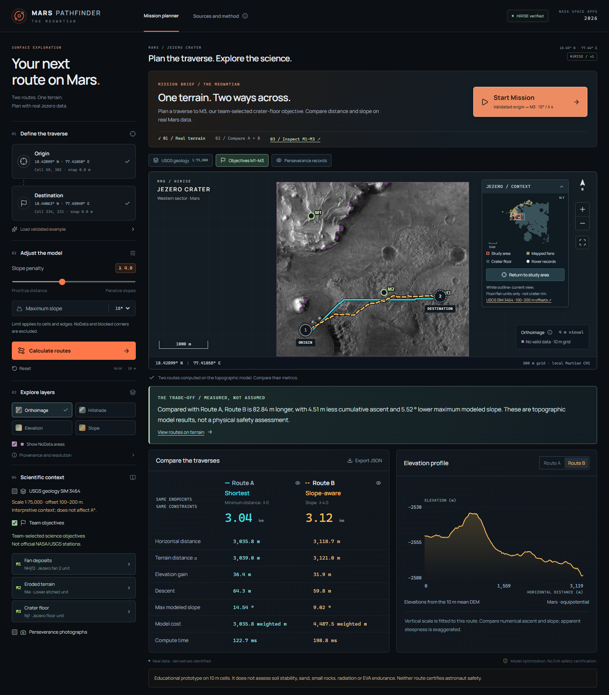

# Mars Pathfinder

**The Meowrtian · NASA Space Apps Challenge 2026**  
Challenge: **Interplanetary Survival Guide: Martian Map**

## [Open the public demo](https://mars-pathfinder-the-meowrtian.netlify.app)

**English release, 15 November:** the public app now defaults to English, including manual controls, scientific cards, provenance, errors and accessible labels. The corrected Apache-2.0 notice and revised seven-slide presentation accompany the verified Start Mission to M3. [Current release evidence](docs/REVISION_PRESENTACION_FINAL.md).

[Public source on GitHub](https://github.com/EduardoManzanoAlcaraz/mars-pathfinder-the-meowrtian) · [Clean source-release checks](docs/SOURCE_RELEASE_CHECKS.md) · [Publication evidence](docs/GITHUB_PUBLICATION.md)

**Jury release, 15 November:** the public demo now includes the lightweight Jezero overview, **Start Mission** to compute the validated origin-to-M3 scenario, clearer A/B comparisons and science-objective cards. The preview and production HTTPS deployments passed fresh desktop/mobile browser checks. [Release evidence and recovery instructions](docs/MEJORA_FINAL_JURADO.md).

A working browser application for exploring a verified region of Jezero crater and comparing scientific traverse candidates on real Martian terrain. HiRISE imagery and stereo topography meet published USGS geology, three team-proposed science objectives and two documented Perseverance photographs.

**Educational and mission-concept prototype. Neither route certifies astronaut safety.**



## Quick start

Prerequisites: **Node.js 24+** and npm. The compact scientific assets are included. No Python, API keys, database, NASA service or large original raster is required for the web build.

```sh
npm ci
npm run build
npm start
```

Open **http://127.0.0.1:3000**. Development: `npm run dev`. Next.js `output: 'export'` generates `out/`; no Next.js server or Netlify Function is required. Serve the export through HTTP/HTTPS, rather than `file://`.

The app uses **Start Mission** for the validated origin-to-M3 traverse: the camera, layers, 15° cap and lambda 4 are set and both routes are calculated afresh. The comparison matches the experiment below and in the presentation. **Load validated example** loads the earlier manual example with its different destination; then select **Calculate routes**. Switch Orthoimage/Hillshade/Elevation/Slope, inspect M1–M3 and the geology/photo cards, and use **Export JSON**.

## Architecture

| Path | Responsibility |
|---|---|
| `app/`, `components/mission/` | Next.js/React interface and OpenLayers in a local Martian CRS |
| `lib/routing/` | Pure TypeScript A*, indexed binary min-heap, eight neighbors, validation and metrics |
| `workers/` | Two module workers; cancellation terminates/recreates workers and rejects stale results |
| `lib/science/`, `lib/map/` | Versioned scientific contracts, source checks, coordinates and exports |
| `scripts/data/` | Python/GDAL preparation and official-source download/discovery scripts |
| `scripts/web/` | Hash-checked asset synchronization and static HTTP server |
| `data/processed/`, `public/data/` | Manifest, compact routing binaries, map visuals and science assets |
| `tests/` | Independent Dijkstra, constraints, metrics, workers, UI and geospatial checks |

The real grid is **394 × 356 cells at 10 m**, north-first, row-major. Elevation/slope use Float32 little-endian; validity uses Uint8. The manifest defines units, coordinates, mask codes and SHA-256 checks. Coordinates use local equirectangular **Mars** metres, not terrestrial WGS84.

## Route model

Both modes block NoData, excessive cell slopes, excessive center-to-center grades and diagonals through blocked corners. Unknown terrain is never filled or treated as traversable.

```text
theta = max(cellSlope_i, cellSlope_j, centerToCenterGrade)
edgeCost = horizontalDistance * (1 + lambda * (theta / thetaReference)^2)
heuristic = horizontal Euclidean distance to the goal
```

**A:** minimum horizontal distance, λ=0. **B:** slope penalty, initial λ=4. The documented comparison uses a 15° cap and 15° reference angle. These are team assumptions, not NASA EVA limits. Exports include horizontal/approximate terrain length, ascent/descent, net elevation, maximum slope, exposure, algorithm cost, measured time, parameters and dataset identity.

## Verified production results

Origin **(column 59, row 302)** to team objective **M3 (334,233)**, dataset `jezero-hirise-v1`, engine 1.0.0. This differs from the default example's destination.

| Metric | Route A, λ=0 | Route B, λ=4 |
|---|---:|---:|
| Horizontal distance | 3,035.81 m | 3,118.65 m |
| Cumulative ascent | 36.39 m | 31.88 m |
| Maximum modeled slope | 14.54° | 9.02° |

The downloaded JSON matches the local engine and passes independent edge audits. Two fresh private Chrome sessions at 1440 × 900 and 390 × 844 passed Start Mission and the manual production flow without authentication. Observed readiness was **2.46 s desktop / 3.30 s mobile viewport** with an empty browser cache on the tested machine/network; the CDN was not purged and this is not a physical-phone test or worldwide performance guarantee. [Current production evidence](docs/final-review-20261115/production/browser-audit.json).

## Scientific sources

| Official source | Actual use |
|---|---|
| [MRO HiRISE stereo products](https://www.uahirise.org/dtm/ESP_045994_1985) | DTM `DTEEC_045994_1985_046060_1985_U01`; orthoimage `ESP_046060_1985_RED_C_01_ORTHO` through its LBL. Prepared 2 m crops, 4 m web display, 10 m routing |
| [USGS SIM 3464, Sun & Stack (2020)](https://doi.org/10.3133/sim3464) | Six clipped polygons representing five units, original names and identifiers preserved |
| [Perseverance raw images](https://mars.nasa.gov/mars2020/multimedia/raw-images/) and [waypoints](https://mars.nasa.gov/mmgis-maps/M20/Layers/json/M20_waypoints.json) | Two authentic Navcam photos with exact same-sol/site/drive joins locating the rover |
| [Mars Trek](https://trek.nasa.gov/mars/) | Catalog/services consulted; no additional Trek raster incorporated |

HiRISE: **NASA/JPL/University of Arizona**. Perseverance: **NASA/JPL-Caltech**. Geology: **USGS, Vivian Z. Sun and Kathryn M. Stack**. Crops, slope, hillshade, masks, display colors, proposed objectives and routes are team derivatives, not extra independent NASA datasets.

Geology retains **100–200 m positional offsets** and never acts as a precise navigation barrier. M1–M3 are team proposals, not official stations. Photos locate rover poses, not visible rock targets. Cell size is not absolute accuracy. Soil stability, sand, small obstacles, radiation, weather and EVA endurance remain outside this model. [Full sources and limits](docs/NASA_RESOURCES.md).

## Tests and reproduction

Chrome/Edge, or `MARS_TEST_BROWSER` pointing to installed Chromium, is required for browser tests. Missing browsers cause failure rather than silently skipped tests.

```sh
npm run typecheck
npm run build
npm test
npm run test:interface
npm run demo:routes
```

The jury release passed **37 routing/worker + 35 interface/science Vitest tests**, typecheck and the static build from the source checkout. The **22-test Python suite** also passed in the full original-data environment, which is deliberately larger than this compact repository. Independent Dijkstra comparisons supplement the suite. [Current executed checks](docs/final-review-20261115/checks.json). [Initial source-publication checks](docs/SOURCE_RELEASE_CHECKS.md) retain their earlier 27-test UI and 8-test synthetic-Python scope.

For optional Python work, create an isolated environment, install the pinned geospatial dependencies, and run the synthetic-primitives suite:

```sh
python -m venv .venv
# Activate the environment for your shell, then:
python -m pip install -r requirements-geospatial.lock.txt
python -m pytest tests/test_geospatial.py -q
```

The remaining Python checks require original downloads, retained official metadata and prepared GeoTIFFs. They are not web-build prerequisites. Large originals, caches, environments and generated builds are excluded from Git. [Reproduction scope](docs/REPRODUCIBILITY.md), [geospatial preparation](docs/VALIDACION_GEOESPACIAL.md), [science preparation](docs/NASA_RESOURCES.md).

## Screenshots and documentation

- [Mobile route comparison](docs/final-review-20261115/production/390-production-comparison.png)
- [Geological uncertainty](docs/final-review-20261115/production/390-production-geology.png)
- [Documented Perseverance image](docs/final-review-20261115/production/390-production-perseverance.png)
- [Plan](PLAN.md), [routes](docs/VALIDACION_RUTAS.md), [scientific sources](docs/NASA_RESOURCES.md), [deployment](docs/DESPLIEGUE_FINAL.md)
- [English submission text](deliverables/spaceapps-2026/SUBMISSION_TEXT_EN.md), [editable seven-slide presentation](deliverables/spaceapps-2026/Mars-Pathfinder-The-Meowrtian.pptx), [seven-page PDF](deliverables/spaceapps-2026/Mars-Pathfinder-The-Meowrtian-Submission.pdf)

Earlier detailed validation reports retain their original language and historical scope. Public copies redact personal workstation paths; scientific values, outcomes and data hashes remain intact.

## License and AI transparency

The team explicitly approved **Apache-2.0 for original code on 15 November 2026**. See [LICENSE](LICENSE), [NOTICE](NOTICE), [licensing scope](docs/LICENSING.md) and [full upstream notices](public/THIRD_PARTY_NOTICES.txt). Third-party software, agency datasets, photographs, fonts and icons retain their own conditions. The current seven-slide deck reflects that approval; earlier validation records retain their historical scope.

**OpenAI Codex** assisted implementation, processing scripts, A*, integration, automated tests, debugging, deployment and documentation. **ChatGPT** assisted planning, challenge interpretation, architecture, instructions and methodology/presentation advice. NASA/USGS supply the observations and published interpretation. No generative image tool created the scientific imagery or measured outcomes, and no LLM service calculates routes at runtime. No agency endorsement is implied.

## Maintainer handoff

[Agent instructions](AGENTS.md) · [Implementation architecture](ARCHITECTURE.md) · [Verified status and next steps](PROJECT_STATUS.md).

Fresh-checkout validation on 19 November 2026 passed the build, typecheck, **37 routing/worker tests** and **35 interface/science tests**. These are local results, separate from the historical production evidence above. No deployment or full original-data Python rerun was performed.

**Windows checkout:** scientific hashes validate exact bytes. Clone with LF preserved, including JSON assets:

```sh
git -c core.autocrlf=false clone https://github.com/EduardoManzanoAlcaraz/mars-pathfinder-the-meowrtian.git
cd mars-pathfinder-the-meowrtian
git config core.autocrlf false
```

In this audit, automatic LF→CRLF conversion changed `public/data/jezero-science-v1/photos.json` from 5536 to 5639 bytes and correctly stopped the build. A checkout using the original Git blob bytes passed. Do not change expected hashes to conceal a checkout conversion. Changing Git configuration alone does not rewrite files already checked out; use a fresh directory and preserve any existing work.
